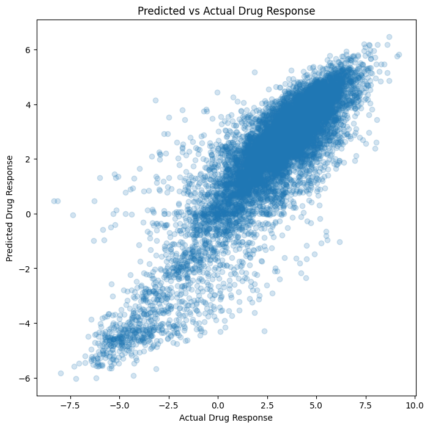

# Drug Response Prediction with Multimodal Deep Learning

Predicting cancer cell-line response to drugs (GDSC2) by combining **molecular fingerprints** of each drug with **gene-expression profiles** of each cell line, and using a **variational autoencoder (VAE)** to compress 17,737 gene-expression features into a 128-dimensional latent space.

## Results

All models were evaluated on the same validation split (random split from PyTDC).

| Model | Cell-line input | RMSE ↓ | MAE ↓ | R² ↑ | Pearson ↑ | Spearman ↑ |
|---|---|---|---|---|---|---|
| Baseline MLP | raw expression (17,737) | 1.456 | 1.107 | 0.710 | 0.875 | 0.841 |
| Deeper MLP | raw expression (17,737) | 1.355 | 1.018 | 0.749 | 0.869 | 0.829 |
| **VAE latent + MLP** | **VAE latent (128)** | **1.305** | **0.969** | **0.767** | **0.876** | **0.837** |

Compressing gene expression with a pretrained VAE (138× fewer features) gave the best error and R², while the regression network on top of it is much smaller than the raw-expression models.

<p align="center">
  
  
</p>

## Pipeline

1. **Data:** GDSC2 via [PyTDC](https://tdcommons.ai/) (`DrugRes(name="GDSC2")`), 64,892 training drug–cell-line pairs. Target `Y` is the drug response value from GDSC2.
2. **Drug features:** SMILES → RDKit molecule → 2,048-bit Morgan fingerprint (radius 2). Invalid SMILES fall back to a zero vector.
3. **Cell-line features:** 17,737-dimensional gene-expression vector per cell line.
4. **Baselines** (`notebooks/01_...`): two-tower PyTorch MLP that encodes drug and cell features separately, concatenates them, and regresses response with MSE loss.
5. **VAE pretraining** (`notebooks/02_...`): encoder 17,737 → 1,024 → 256 → (μ, log σ²) ∈ ℝ¹²⁸, symmetric decoder, loss = reconstruction MSE + β·KL (β = 1e-4). The latent mean μ replaces raw expression as the cell-line input to a smaller regressor.

## Repository layout

```
notebooks/
  01_data_pipeline_and_baselines.ipynb   # data loading, featurization, MLP baselines
  02_vae_pretraining.ipynb               # VAE pretraining + latent regressor (run after 01, same kernel)
assets/                                  # plots exported from the notebooks
requirements.txt
```

## Running it

```bash
python -m venv .venv && source .venv/bin/activate
pip install -r requirements.txt
jupyter lab
```

Run `01_data_pipeline_and_baselines.ipynb`, then `02_vae_pretraining.ipynb` in the same kernel. The GDSC2 dataset is downloaded automatically by PyTDC on first run. Note that the full gene-expression matrix is about 4.6 GB in float32, so 16 GB+ of RAM is recommended.

## Limitations and next steps

- Metrics are on the validation split; the held-out test split has not been scored yet.
- The random split lets the same drugs and cell lines appear in both train and validation. Cold-drug and cold-cell-line splits would measure generalization to unseen compounds and tumors.
- Gene-expression features are not standardized, and runs are not seeded, so results vary somewhat between runs.
