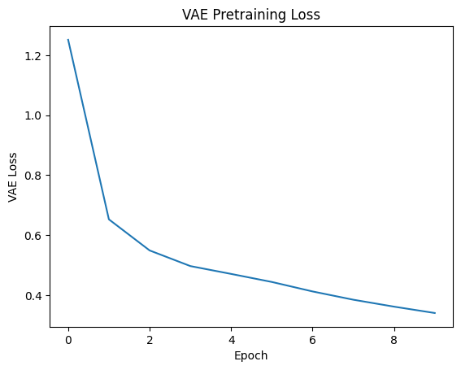

# Drug Response Prediction with Multimodal Deep Learning

Predicting cancer cell-line response to drugs (GDSC2) from **molecular fingerprints** of each drug and **gene-expression profiles** of each cell line, with a **variational autoencoder (VAE)** that compresses 17,737 expression features into a 128-dimensional latent space.

The headline result is not the accuracy number — it is how much that number depends on how the data is split.

## Results

All metrics below are on the **test split**, which was never used for model selection or early stopping. Seeded, with gene expression standardized using training-split statistics only.

### Random split — drugs and cell lines appear in both train and test

| Model | Cell-line input | RMSE ↓ | MAE ↓ | R² ↑ | Pearson ↑ | Spearman ↑ |
|---|---|---|---|---|---|---|
| Raw expression MLP | 17,737 features | **0.980** | **0.740** | **0.870** | **0.934** | **0.904** |
| VAE latent + MLP | 128-d latent | 1.030 | 0.769 | 0.856 | 0.926 | 0.896 |

### Cold-cell-line split — no test cell line is ever seen in training

| Model | Cell-line input | RMSE ↓ | MAE ↓ | R² ↑ | Pearson ↑ | Spearman ↑ |
|---|---|---|---|---|---|---|
| Raw expression MLP | 17,737 features | 1.307 | 0.989 | 0.769 | 0.880 | 0.832 |
| VAE latent + MLP | 128-d latent | **1.297** | **0.981** | **0.773** | **0.879** | **0.831** |

### Cold-drug split — no test drug is ever seen in training

| Model | Cell-line input | RMSE ↓ | MAE ↓ | R² ↑ | Pearson ↑ | Spearman ↑ |
|---|---|---|---|---|---|---|
| Raw expression MLP | 17,737 features | **2.620** | **1.997** | **0.220** | **0.470** | **0.380** |
| VAE latent + MLP | 128-d latent | 2.683 | 2.039 | 0.182 | 0.429 | 0.336 |

## What these numbers mean

**The two cold splits fail very differently, and that difference is the most informative result here.**

| Asked to generalize to… | Test R² | |
|---|---|---|
| nothing new (random split) | 0.87 | |
| an **unseen cell line** | 0.77 | holds up |
| an **unseen drug** | 0.22 | collapses |

A new tumor is largely fine: gene expression is a dense, continuous signal, and a cell line the model has never seen still lands near ones it has. A new compound is not. Most of the apparent skill on the random split comes from having seen that same drug against other cell lines, not from chemistry that transfers.

This points at the drug representation rather than the expression encoder. A 2,048-bit Morgan fingerprint is a lookup of substructures that were present in training; for a scaffold unlike anything seen, it carries almost no usable signal. Swapping it for a learned molecular encoder (a GNN or a pretrained chemical language model) is where the next gain is, and compressing expression further is not.

The practical reading: this model is useful for filling in a known drug against new tumors, and should not be trusted to screen a novel compound.

**The VAE's advantage is cost, not accuracy.** Compressing expression 138× costs about 0.014 R² on the random split and buys a far cheaper model:

| | Parameters | Training time |
|---|---|---|
| Raw expression regressor | 38.8 M | 16.2 s/epoch |
| VAE latent regressor | 0.6 M | 2.3 s/epoch (+ 7.3 s one-off VAE pretraining) |

That is **65× fewer parameters and 7.1× faster epochs**, measured back to back in one process on the same device (Apple M-series MPS, batch size 64, best of 3 epochs; see `src/benchmark_cost.py` and `results/cost_benchmark.json`). An earlier version of this project found the VAE *more* accurate; that turned out to be an artifact of the raw-expression model being undertrained, and the gap disappeared once both models got standardized inputs and early stopping. Both numbers are kept here rather than quietly dropping the old one.

<p align="center">
  
  
</p>

## Pipeline

1. **Data** — GDSC2 via [PyTDC](https://tdcommons.ai/) (`DrugRes(name="GDSC2")`): 92,703 drug–cell-line pairs over 137 drugs and 805 cell lines.
2. **Drug features** — SMILES → RDKit molecule → 2,048-bit Morgan fingerprint (radius 2); invalid SMILES fall back to a zero vector.
3. **Cell-line features** — 17,737-dimensional gene-expression vector, standardized with training-split mean and standard deviation.
4. **VAE pretraining** — encoder 17,737 → 1,024 → 256 → (μ, log σ²) ∈ ℝ¹²⁸ with a symmetric decoder; loss is reconstruction MSE + β·KL (β = 1e-4). Pretrained only on cell lines present in the training split, so no test-set expression leaks in.
5. **Regression** — a two-tower MLP encodes drug and cell-line features separately, concatenates them, and regresses response under MSE, with early stopping on the validation split (patience 5).

### Memory note

The raw frame repeats a cell line's full expression vector on every row, which is about 4.6 GB in float32. Deduplicating to one row per unique cell line and indexing into that matrix brings the whole dataset under 100 MB and makes the experiments runnable on a laptop.

## Repository layout

```
src/
  run_experiment.py      # training + evaluation for all three splits and both models
  benchmark_cost.py      # controlled per-epoch cost comparison
notebooks/
  01_data_pipeline_and_baselines.ipynb   # original exploration: featurization + MLP baselines
  02_vae_pretraining.ipynb               # original VAE pretraining (run after 01, same kernel)
results/                 # metrics written by the scripts
assets/                  # plots
```

The notebooks are the original exploratory work and report validation-split metrics from before standardization and early stopping were added. `src/` supersedes them; the tables above come from `src/run_experiment.py`.

## Running it

```bash
python -m venv .venv && source .venv/bin/activate
pip install -r requirements.txt

python src/run_experiment.py --split random --model vae
python src/run_experiment.py --split random --model raw
python src/run_experiment.py --split cold_cell --model vae
python src/run_experiment.py --split cold_cell --model raw
python src/run_experiment.py --split cold_drug --model vae
python src/run_experiment.py --split cold_drug --model raw
```

PyTDC downloads GDSC2 on first run. The scripts use Apple MPS or CUDA when available and fall back to CPU.

## Limitations and next steps

- **Single seed.** Each number is one run; the spread across seeds has not been measured, so small gaps (0.870 vs 0.856 on the random split, or the near-tie on the cold-cell split) should not be over-read. The cold-drug gap is far larger than any plausible seed noise.
- **Fingerprints are the bottleneck.** The contrast between the cold-cell (0.77) and cold-drug (0.22) splits points at the molecular representation, not the expression encoder. Replacing Morgan fingerprints with a learned molecular encoder (a GNN or a pretrained chemical language model) is the clear next experiment.
- **No hyperparameter search.** Architecture, learning rate, latent size and β were taken from the original notebooks rather than tuned.
